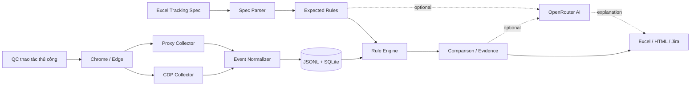
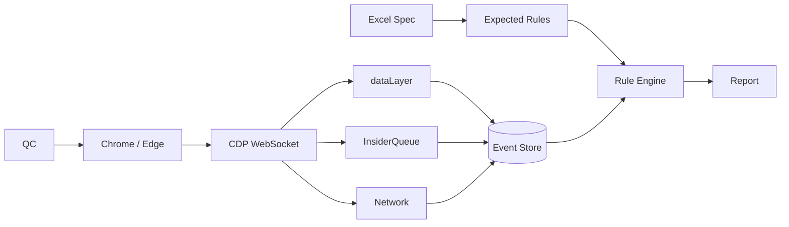
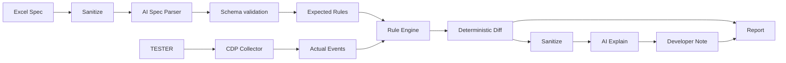
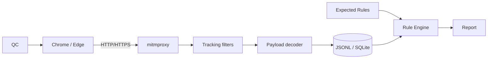

# Kế hoạch triển khai hệ thống Event Tracking QA — ba phương án

## Executive summary

Tài liệu Markdown hoàn chỉnh để bàn giao thẳng cho **Sol 6.1 Max** đã được tạo tại đây: [Event_Tracking_QA_3_Phuong_An_Implementation_Plan.md](sandbox:/mnt/data/Event_Tracking_QA_3_Phuong_An_Implementation_Plan.md).

Mục tiêu của sản phẩm là bỏ quy trình hiện tại kiểu **F12 → tìm `dataLayer` / `InsiderQueue` / Network → copy JSON → mở Excel → tự so sánh**, nhưng vẫn giữ cách QA thao tác nghiệp vụ thủ công. Công cụ sẽ tự thu thập bằng chứng, chuẩn hóa event, đối chiếu với specification và xuất báo cáo.

Kiến trúc nên được xây thành **một sản phẩm duy nhất có nhiều collector adapter**, không phải ba project tách biệt:



CDP là giao thức mà Chrome DevTools sử dụng để instrument, inspect và debug trình duyệt; nó chia API thành các domain như `Network`, `Runtime`, `Page`, `Target` và giao tiếp bằng JSON qua WebSocket. citeturn772235search4turn772235search0turn772235search1

Ba phương án được chốt như sau:

| Phương án | Collector | AI | `dataLayer` | `InsiderQueue` | Network | Vai trò |
|---|---|---|---:|---:|---:|---|
| **CDP no-AI** | CDP | Không | Có | Có | Có | MVP, core production |
| **CDP + AI** | CDP | OpenRouter | Có | Có | Có | Product đầy đủ |
| **Network Proxy no-AI** | mitmproxy/Fiddler | Không | Không trực tiếp | Không trực tiếp | Có | Fallback và kiểm tra tầng request |

Khuyến nghị triển khai là **CDP no-AI trước → thêm OpenRouter → thêm Proxy adapter**. Lý do là phần quan trọng nhất cần ổn định trước là collector + schema + rule engine. AI chỉ nên hỗ trợ hiểu yêu cầu và viết giải thích; **AI không được là bộ phận duy nhất quyết định PASS/FAIL**.

Chrome hiện yêu cầu đặc biệt khi remote debugging: từ Chrome 136, `--remote-debugging-port` và `--remote-debugging-pipe` phải dùng cùng `--user-data-dir` trỏ tới một thư mục khác profile mặc định. Google khuyến nghị dùng profile riêng để cô lập phiên debug. citeturn849559search0 Edge cũng hỗ trợ DevTools Protocol, nhưng tổ chức có thể chặn remote debugging bằng policy `RemoteDebuggingAllowed`. citeturn849559search2turn772235search3

## Mục tiêu, phạm vi và kiến trúc dữ liệu

MVP tập trung Web OTA chạy trên **Chrome và Microsoft Edge desktop**, người QC tự thao tác flow Hotel, Golf, Merchandise, Flight… Công cụ không phụ thuộc Playwright, Selenium hay browser extension.

Workbook hiện tại `Martech_WebOTA_20260501.xlsx` có thể dùng làm nguồn specification. Qua kiểm tra workbook, sheet `Tổng hợp Event tracking` có cấu trúc:

| Cột | Ý nghĩa |
|---|---|
| STT | ID |
| Nền tảng | GA4 / Insider |
| Luồng | Hotel / Merchandise / … |
| Event Name | Event cần kiểm tra |
| Event Description | Trigger/ngữ nghĩa |
| DataLayer Sample | Payload mẫu |
| Note | Ghi chú |
| check prod | Trạng thái lịch sử |

Sheet này ghi `Latest update: 20/10/2026`, vì vậy nên được chọn làm source-of-truth ban đầu nếu BA xác nhận.

Một ví dụ thực tế trong file là Hotel `search_submit`:

```javascript
dataLayer.push({
  event: "search_submit",
  service: "hotel",
  destination: "Phú Quốc",
  destination_id: "285dd301-f562-4969-a6b8-b5dd2383a1cb",
  service_start_date: "2026-08-06",
  service_end_date: "2026-08-07",
  service_duration: 1,
  quantity: 1,
  quantity_adult: 2,
  quantity_child: 0,
  quantity_infant: 0,
  search_source: "home_searchbox",
  gtm.uniqueEventId: 17
})
```

Điểm rất quan trọng là **sample payload không đồng nghĩa với expected exact value**.

Trong sheet `Merchandise 3009`, sample `search_submit` có:

```json
{
  "event": "search_submit",
  "service": "merchandise",
  "search_term": "keychain",
  "search_source": "listing_searchbox"
}
```

Trong actual lịch sử lại có:

```json
{
  "event": "search_submit",
  "service": "merchandise",
  "search_term": "snack",
  "search_source": "listing_searchbox"
}
```

và kết quả được đánh **PASS**.

Do đó rule engine phải phân biệt:

| Loại field | Ví dụ | Rule |
|---|---|---|
| Fixed | `service="hotel"` | exact equality |
| Dynamic UI | `search_term` | so với context thao tác |
| Dynamic API | `destination_id` | so với API/context |
| Type | `quantity_adult` | integer |
| Pattern | UUID | regex |
| Technical | `gtm.uniqueEventId` | ignore |
| Optional | tùy flow | conditional |

Schema actual event đề xuất:

```json
{
  "schema_version": "1.0",
  "session_id": "S-20261029-001",
  "test_case_id": "TC-HOTEL-SEARCH-001",
  "step_id": "STEP-03",

  "captured_at": "2026-10-29T10:30:11.452+07:00",

  "source": "GA4",
  "layer": "JS_QUEUE",
  "queue_name": "dataLayer",

  "event_name": "search_submit",

  "page": {
    "url": "https://example/...",
    "title": "Hotel",
    "frame_id": "..."
  },

  "payload": {
    "event": "search_submit",
    "service": "hotel"
  },

  "correlation": {
    "action": "submit_search",
    "action_at": "...",
    "delta_ms": 84
  },

  "privacy": {
    "redacted": true
  }
}
```

Expected rule:

```json
{
  "event_name": "search_submit",

  "count": {
    "min": 1,
    "max": 1
  },

  "within_ms": 3000,

  "fields": {
    "event": {
      "op": "eq",
      "value": "search_submit"
    },

    "service": {
      "op": "eq",
      "value": "hotel"
    },

    "destination": {
      "op": "ref",
      "value": "context.search.destination_name"
    },

    "destination_id": {
      "op": "regex",
      "value": "^[0-9a-fA-F-]{36}$"
    },

    "quantity_adult": {
      "op": "ref",
      "value": "context.search.adults"
    },

    "gtm.uniqueEventId": {
      "op": "ignore"
    }
  }
}
```

Rule engine tối thiểu cần hỗ trợ `eq`, `exists`, `not_exists`, `type`, `regex`, `one_of`, `range`, `ref`, `subset`, `ignore`, event count, ordering, timing và duplicate detection.

Một nguyên tắc bắt buộc là phân biệt ba tầng evidence:

```text
JS_QUEUE
   ↓
TRACKING_REQUEST
   ↓
VENDOR_INGESTION
```

Ví dụ:

```text
dataLayer có search_submit
        ↓
GA4 request không xuất hiện
```

thì báo:

```text
JS_QUEUE = PASS
NETWORK = FAIL
```

chứ không được nói chung chung "`search_submit` thiếu".

Google khuyến nghị dùng Network để thấy các request như `google-analytics.com/g/collect` hoặc `analytics.google.com/g/collect`, còn DebugView/Realtime dùng để xác nhận sự kiện đã được Analytics thu nhận. citeturn908406search1turn908406search17

## Phương án CDP không AI

Đây nên là **MVP đầu tiên**.

Luồng:



CDP cung cấp endpoint `/json/version` và `/json/list`; target trả về `webSocketDebuggerUrl` để client attach. citeturn772235search4

**Chrome Windows:**

```bat
mkdir "%LOCALAPPDATA%\EventQA\ChromeProfile"

"C:\Program Files\Google\Chrome\Application\chrome.exe" ^
  --remote-debugging-port=9222 ^
  --user-data-dir="%LOCALAPPDATA%\EventQA\ChromeProfile" ^
  --no-first-run ^
  --no-default-browser-check
```

Chrome 136+ yêu cầu custom user data directory khi dùng remote debugging. citeturn849559search0

**Edge Windows:**

```bat
mkdir "%LOCALAPPDATA%\EventQA\EdgeProfile"

"C:\Program Files (x86)\Microsoft\Edge\Application\msedge.exe" ^
  --remote-debugging-port=9223 ^
  --user-data-dir="%LOCALAPPDATA%\EventQA\EdgeProfile" ^
  --no-first-run
```

Edge policy có thể cho phép hoặc cấm các switch remote-debugging; nếu policy bị disable thì ứng dụng phải báo rõ cho QC/IT thay vì tìm cách bypass. citeturn772235search3

Smoke test:

```powershell
Invoke-RestMethod http://127.0.0.1:9222/json/version
Invoke-RestMethod http://127.0.0.1:9222/json/list
```

Các CDP domain chính:

| Domain | Sử dụng |
|---|---|
| `Network` | request/response |
| `Runtime` | JavaScript context/binding |
| `Page` | inject JS từ đầu document |
| `Target` | tabs/frames/new targets |

`Network` có các event/method như `requestWillBeSent`, `responseReceived`, `loadingFinished`, `loadingFailed`, `getRequestPostData` và `getResponseBody`. citeturn772235search0

`Runtime.addBinding` tạo một JavaScript function trong execution context; khi page gọi function đó, CDP phát `Runtime.bindingCalled`. citeturn772235search1

`Page.addScriptToEvaluateOnNewDocument` chạy script trong mỗi frame **trước khi page script chạy**, rất phù hợp để cài collector. citeturn772235search2

Python minimal:

```python
import asyncio
import json

import httpx
import websockets


async def find_page(port=9222):
    async with httpx.AsyncClient() as client:
        targets = (
            await client.get(
                f"http://127.0.0.1:{port}/json/list"
            )
        ).json()

    pages = [
        x for x in targets
        if x.get("type") == "page"
        and x.get("webSocketDebuggerUrl")
    ]

    if not pages:
        raise RuntimeError("Không tìm thấy page target")

    return pages[0]["webSocketDebuggerUrl"]
```

Raw CDP **không có method `postDataJSON()`**. Với Network phải dùng:

```text
request.postData
```

hoặc:

```text
Network.getRequestPostData
```

rồi tự decode JSON/form data. CDP chính thức expose `Network.getRequestPostData`. citeturn772235search0

Helper:

```python
import json
from urllib.parse import parse_qs


def decode_post_data(raw, content_type=""):
    if not raw:
        return None

    content_type = content_type.lower()

    if "application/json" in content_type:
        try:
            return json.loads(raw)
        except json.JSONDecodeError:
            return {
                "_raw": raw,
                "_decode_error": "invalid_json",
            }

    if "application/x-www-form-urlencoded" in content_type:
        parsed = parse_qs(raw)

        return {
            k: v[0] if len(v) == 1 else v
            for k, v in parsed.items()
        }

    try:
        return json.loads(raw)
    except Exception:
        return {"_raw": raw}
```

Phần quan trọng nhất là hook `dataLayer` và `InsiderQueue`.

```javascript
(() => {
  const emit = (queue, item) => {
    try {
      window.__eventqa_emit(
        JSON.stringify({
          queue,
          item,
          href: location.href,
          ts: Date.now()
        })
      );
    } catch (_) {}
  };

  function hook(name) {
    const arr = window[name];

    if (!Array.isArray(arr)) return false;
    if (arr.__eventqa_hooked__) return true;

    // Capture dữ liệu tồn tại trước khi hook.
    for (const item of arr) {
      emit(name, item);
    }

    const originalPush = arr.push.bind(arr);

    Object.defineProperty(
      arr,
      "__eventqa_hooked__",
      { value: true }
    );

    arr.push = (...items) => {
      for (const item of items) {
        emit(name, item);
      }

      return originalPush(...items);
    };

    return true;
  }

  hook("dataLayer");
  hook("InsiderQueue");

  const timer = setInterval(() => {
    const dl = hook("dataLayer");
    const iq = hook("InsiderQueue");

    if (dl && iq) {
      clearInterval(timer);
    }
  }, 25);
})();
```

Python:

```python
await cdp.send(
    "Runtime.addBinding",
    {
        "name": "__eventqa_emit"
    }
)

await cdp.send(
    "Page.addScriptToEvaluateOnNewDocument",
    {
        "source": INJECT_JS,
        "runImmediately": True
    }
)
```

Khi page gọi:

```javascript
window.__eventqa_emit(...)
```

Python nhận:

```text
Runtime.bindingCalled
```

và ghi event.

Storage nên gồm cả JSONL và SQLite:

```text
runs/
  S-20261029-001/
    session.json
    events.jsonl
    report.xlsx

eventqa.db
```

JSONL là append-only để nếu app crash thì các record trước đó vẫn còn.

SQLite để correlation/query/report.

```sql
CREATE TABLE events (
    id INTEGER PRIMARY KEY AUTOINCREMENT,

    session_id TEXT,
    test_case_id TEXT,
    step_id TEXT,

    captured_at TEXT,

    source TEXT,
    layer TEXT,
    event_name TEXT,

    page_url TEXT,

    payload_json TEXT,

    request_id TEXT,
    status INTEGER
);
```

Ưu điểm của phương án này là không có chi phí AI, deterministic và dễ audit.

## Phương án CDP kết hợp AI qua OpenRouter

Phương án này **không thay CDP** mà thêm một lớp AI.



OpenRouter hỗ trợ endpoint:

```text
POST /api/v1/chat/completions
```

với Bearer API key và request format tương thích kiểu OpenAI Chat Completions. citeturn742678search0

Tại **29/10/2026**, OpenRouter liệt kê các free model phổ biến như Nemotron 3 Ultra, Nemotron 3.5 Super VL và Nemotron 3.5 Lightning; OpenRouter cũng có `openrouter/free` để tự route tới free model phù hợp. citeturn742678search2turn451991search4

Free variants hiện bị giới hạn khoảng **20 request/phút, 50 request/ngày** với tài khoản chưa mua credit; giới hạn ngày tăng lên 1.000 sau khi account đạt mức credit được OpenRouter quy định. Vì vậy free tier phù hợp PoC nhưng không nên thiết kế hệ thống production dựa vào quota này. citeturn801256search0

Model config đề xuất hiện tại:

```env
OPENROUTER_API_KEY=replace_me

OPENROUTER_MODEL_SPEC=nvidia/nemotron-3.5-super-vl:free

OPENROUTER_MODEL_EXPLAIN=openrouter/free

AI_ENABLED=true
AI_MAX_RETRIES=3
AI_TIMEOUT_SEC=60
```

`nvidia/nemotron-3.5-super-vl:free` hiện hỗ trợ structured output thông qua JSON schema, nên hợp với nhiệm vụ convert Excel description → normalized rule. citeturn451991search7

`nvidia/nemotron-3-ultra-550b-a55b:free` hiện thích hợp planning/reasoning nhưng trang model cho biết không hỗ trợ `response_format`, vì vậy không nên dùng nó làm model chính cho strict JSON extraction. citeturn451991search6

Không nên chọn `poolside/laguna-s-2.1:free` làm default vào thời điểm này vì OpenRouter đang ghi model sẽ ngừng ngày **31/10/2026**, chỉ hai ngày sau ngày nghiên cứu hiện tại. citeturn451991search2

Code:

```python
import os
import httpx


async def call_openrouter(messages, model):
    headers = {
        "Authorization":
            f"Bearer {os.environ['OPENROUTER_API_KEY']}",

        "Content-Type":
            "application/json",
    }

    body = {
        "model": model,
        "messages": messages,
        "temperature": 0.1,
        "max_tokens": 5000,
    }

    async with httpx.AsyncClient(
        timeout=60
    ) as client:

        res = await client.post(
            "https://openrouter.ai/api/v1/chat/completions",
            headers=headers,
            json=body,
        )

        res.raise_for_status()

        data = res.json()

        return (
            data["choices"][0]
                ["message"]
                ["content"]
        )
```

Prompt đọc specification:

```text
SYSTEM

Bạn là BA/QC chuyên kiểm thử event tracking.

Nhiệm vụ:
Chuyển specification được cung cấp thành JSON rule.

Nguyên tắc:

- Không tự tạo field không có trong requirement.
- Sample value không mặc định là exact value.
- Field lấy từ UI, API, session, UUID,
  transaction, ngày tháng hoặc search term
  phải được xem xét là dynamic.
- Nếu không chắc chắn phải đánh:
  needs_review=true.
- Không quyết định PASS/FAIL.

OUTPUT phải tuân JSON schema.
```

Input:

```text
Platform:
{{platform}}

Flow:
{{flow}}

Event:
{{event_name}}

Description:
{{description}}

Sample:
{{payload}}

Mapping/Notes:
{{notes}}
```

Expected AI output:

```json
{
  "event_name": "search_submit",

  "source": "GA4",

  "trigger":
    "Submit tìm kiếm Hotel",

  "fields": {
    "service": {
      "classification": "fixed",
      "op": "eq",
      "expected": "hotel"
    },

    "destination": {
      "classification": "dynamic",
      "op": "ref",
      "context_ref":
        "context.search.destination"
    }
  },

  "needs_review": false
}
```

Prompt AI sau test **không được cho AI tự tính verdict**.

Input cho AI phải là:

```json
{
  "deterministic_verdict": "FAIL",

  "issues": [
    {
      "code": "MISSING_FIELD",
      "path": "destination_id"
    }
  ]
}
```

AI chỉ tạo:

```text
Event search_submit đã được ghi nhận ở dataLayer,
nhưng thiếu destination_id.

Expected:
destination_id tồn tại.

Actual:
destination_id không có.

Cần Dev kiểm tra phần mapping destination ID
khi build payload search_submit.
```

OpenRouter không tự dùng input/output khách hàng để train model của OpenRouter, nhưng request được truyền tới provider mà OpenRouter route tới; các provider khác nhau có chính sách retention/training khác nhau. OpenRouter khuyến nghị kiểm tra provider data policy và cung cấp Zero Data Retention routing. citeturn742678search5turn801256search1turn801256search3

Do đó phải mask trước AI:

```text
Authorization
Cookie
Set-Cookie
access_token
refresh_token
api_key
phone
email
session token
```

Ví dụ:

```python
SENSITIVE_HEADERS = {
    "authorization",
    "cookie",
    "set-cookie",
    "x-api-key",
}


def redact_headers(headers):
    result = {}

    for key, value in headers.items():
        if key.lower() in SENSITIVE_HEADERS:
            result[key] = "***"
        else:
            result[key] = value

    return result
```

Không gọi AI cho từng event.

Nên:

```text
Import Excel
   ↓
AI normalize 1 lần
   ↓
Cache rule

...

100 event actual
   ↓
Rule Engine
   ↓
96 PASS
4 FAIL
   ↓
AI chỉ xử lý 4 FAIL
```

Cách này giảm quota rất nhiều.

## Phương án Network Proxy không AI

Collector thứ ba là **mitmproxy**.

mitmproxy có ba chương trình chính: `mitmproxy` dạng interactive terminal, `mitmweb` dạng web UI và `mitmdump` dạng non-interactive CLI. citeturn769217search0turn769217search2

Luồng:



Trên Windows, mitmproxy có installer chính thức, Microsoft Store hoặc standalone binary; sau khi cài, `mitmproxy`, `mitmdump` và `mitmweb` được thêm vào PATH. citeturn769217search2

Khởi chạy:

```powershell
mitmdump `
  --listen-host 127.0.0.1 `
  --listen-port 8080 `
  -w runs\raw_flows.mitm
```

mitmproxy mặc định hoạt động như HTTP proxy tại `localhost:8080`. citeturn769217search4

Với addon:

```powershell
mitmdump `
  --listen-host 127.0.0.1 `
  --listen-port 8080 `
  -s .\app\collectors\mitm_addon.py `
  -w runs\raw_flows.mitm
```

mitmproxy cho phép load Python addon qua `-s`; addon có thể hook các event request/response. citeturn769217search3

Để đọc HTTPS, browser cần tin CA của mitmproxy. Tài liệu chính thức hướng dẫn route browser qua proxy rồi truy cập `mitm.it` để cài CA. citeturn849559search4turn769217search4

Filter language hỗ trợ:

```text
~d  domain
~u  URL
~m  method
~bq request body
~t  content type
```

citeturn769217search1

Ví dụ:

```text
~d "google-analytics\.com|analytics\.google\.com"
|
~u "insider|collect|tracking|event"
```

Google xác nhận GA4 web traffic thường có request tới:

```text
google-analytics.com/g/collect
analytics.google.com/g/collect
```

citeturn908406search1

Addon:

```python
import json
import re
import time

from urllib.parse import parse_qs
from mitmproxy import http


TRACK_RE = re.compile(
    r"google-analytics\.com"
    r"|analytics\.google\.com"
    r"|insider"
    r"|/collect"
    r"|/event",
    re.I
)


def decode_body(flow):
    raw = (
        flow.request.get_text(
            strict=False
        )
        or ""
    )

    ct = (
        flow.request.headers
            .get("content-type", "")
            .lower()
    )

    if "json" in ct:
        try:
            return json.loads(raw)
        except Exception:
            return {
                "_raw": raw,
                "_decode_error": "json"
            }

    if (
        "application/x-www-form-urlencoded"
        in ct
    ):
        parsed = parse_qs(
            raw,
            keep_blank_values=True
        )

        return {
            key:
                values[0]
                if len(values) == 1
                else values

            for key, values
            in parsed.items()
        }

    return {
        "_raw": raw
    }


def request(flow: http.HTTPFlow):

    if not TRACK_RE.search(
        flow.request.pretty_url
    ):
        return

    rec = {
        "timestamp": time.time(),

        "layer":
            "NETWORK_REQUEST",

        "url":
            flow.request.pretty_url,

        "method":
            flow.request.method,

        "body":
            decode_body(flow)
    }

    with open(
        "runs/proxy_events.jsonl",
        "a",
        encoding="utf-8"
    ) as f:

        f.write(
            json.dumps(
                rec,
                ensure_ascii=False
            )
            + "\n"
        )
```

mitmproxy filter expressions và addon scripting đều là khả năng chính thức của tool. citeturn769217search1turn769217search3

Decoder nên theo pipeline:

```text
Content-Type
     ↓
JSON?
     ↓
Form URL encoded?
     ↓
Query string?
     ↓
JSON array/batch?
     ↓
NDJSON?
     ↓
Known Base64 field?
     ↓
Vendor adapter?
     ↓
UNPARSED
```

Không được tự đoán encryption.

Nếu payload thực sự là protobuf, encrypted binary hoặc vendor format riêng:

```json
{
  "decode_status": "UNPARSED",
  "raw_hash": "...",
  "content_type": "...",
  "reason": "unsupported_format"
}
```

Điểm yếu lớn nhất của proxy:

```text
dataLayer.push(...)
        ↓
GTM tag bị lỗi
        ↓
không gửi request
```

Proxy chỉ nhìn thấy:

```text
không có request
```

và **không biết `dataLayer` đã có event**.

CDP thì có thể nhìn cả hai tầng:

```text
dataLayer
+
Network
```

Do đó proxy là fallback hoặc tool kiểm chứng Network chứ không nên thay CDP hoàn toàn đối với requirement hiện tại.

HTTPS interception cũng tạo trust boundary mới; CA chỉ nên cài trong môi trường test được phê duyệt. mitmproxy khuyến nghị cài CA riêng cho client được kiểm thử. citeturn849559search4

Fiddler có thể được giữ như lựa chọn GUI cho QC. FiddlerCore hỗ trợ HTTPS decryption, system proxy và HTTP/2 capture, nhưng nếu xây sản phẩm tự động hóa bằng Python thì mitmproxy thuận tiện hơn cho version-control và addon scripting. citeturn512721search1

## PoC, report và acceptance criteria

PoC nên dùng **ba event thật trong workbook**.

**PoC A — Hotel GA4 `search_submit`**

Mục tiêu:

```text
Fixed + dynamic fields
```

Steps:

```text
Start session
↓
Chọn Hotel search test case
↓
Start Step
↓
Nhập destination
↓
Nhập ngày
↓
Nhập guest
↓
Search
↓
Collector tự bắt event
↓
Complete Step
↓
Validate
```

Expected:

```text
event = search_submit
service = hotel

destination
    = giá trị UI

destination_id
    = context/API

service_duration
    = nights

quantity_adult
    = guest count
```

**PoC B — Merchandise GA4 `search_submit`**

Đây là test bắt buộc của dynamic engine.

Specification sample:

```text
search_term = keychain
```

Tester nhập:

```text
snack
```

Actual:

```json
{
  "event": "search_submit",
  "service": "merchandise",
  "search_term": "snack",
  "search_source": "listing_searchbox"
}
```

Kết quả đúng phải là:

```text
PASS
```

nếu context:

```text
context.search.term = snack
```

Nếu tool báo:

```text
FAIL:
expected keychain
actual snack
```

thì rule engine thiết kế sai.

**PoC C — Insider Product Detail**

Mục tiêu:

```text
InsiderQueue
+
nested payload
+
network evidence
```

Kỳ vọng:

```text
JS_QUEUE
product_detail_page_view
       ↓
NETWORK
Insider tracking request
```

Nếu queue PASS nhưng request không có:

```text
JS_QUEUE_PASS

NETWORK_MISSING
```

Excel output nên có sáu sheet:

| Sheet | Nội dung |
|---|---|
| Run Summary | Tổng quan session |
| Test Cases | Test case |
| Expected Events | Expected rule |
| Actual Events | Evidence |
| Comparison | Exact diff |
| Bug Reports | Bug-ready output |

Sample:

| Test case | Event | Layer | Field | Expected | Actual | Verdict |
|---|---|---|---|---|---|---|
| Hotel Search | search_submit | JS_QUEUE | service | hotel | hotel | PASS |
| Hotel Search | search_submit | JS_QUEUE | destination_id | exists | null | FAIL |
| Merch Search | search_submit | JS_QUEUE | search_term | context=`snack` | snack | PASS |

Diff:

```json
{
  "test_case_id":
    "TC-HOTEL-SEARCH-001",

  "event_name":
    "search_submit",

  "verdict":
    "FAIL",

  "issues": [
    {
      "code":
        "MISSING_FIELD",

      "path":
        "destination_id",

      "expected": {
        "op": "exists",
        "type": "string"
      },

      "actual":
        null,

      "evidence_id":
        "EV-000184"
    }
  ]
}
```

Jira template:

```text
[Tracking][Hotel][GA4]
search_submit thiếu destination_id

Environment:
{{environment}}

Browser:
{{browser}} {{version}}

Test case:
{{test_case_id}}

Steps:
1. Mở Hotel Home
2. Nhập điều kiện tìm kiếm
3. Bấm Tìm kiếm

Expected:
search_submit có destination_id.

Actual:
search_submit được fire,
nhưng destination_id không tồn tại.

Evidence:
{{evidence_id}}

Layer:
JS_QUEUE

Network:
{{network_result}}

Verdict:
FAIL / MISSING_FIELD

AI Note:
{{optional}}
```

Acceptance criteria quan trọng:

```text
Không cần F12.

Không cần Playwright.

Không cần browser extension.

Chrome chạy được.

Edge chạy được.

dataLayer capture được.

InsiderQueue capture được.

Network request capture được.

Reload không làm hook nhân đôi.

Dynamic field không so exact sample.

Missing field phát hiện đúng.

Duplicate phát hiện đúng.

Sai order phát hiện đúng.

NOT_EXECUTED không biến thành FAIL.

JSONL không mất dữ liệu khi app crash.

Secrets không xuất hiện trong log.

AI tắt vẫn chạy toàn hệ thống.

AI hết quota vẫn export report.

Mỗi FAIL trace được về evidence_id.
```

Google lưu ý DebugView hiển thị event trong thời gian thực gần như ngay lập tức, còn Realtime có thể xuất hiện sau vài phút và report chuẩn có thể cần lâu hơn. Vì vậy nên coi DebugView là bước xác nhận bổ sung khi cần kiểm tra ingestion thực tế. citeturn908406search0turn908406search17

## Lộ trình giao Sol 6.1 Max và rủi ro kỹ thuật

Không nên prompt Sol 6.1 Max kiểu:

```text
Hãy làm app kiểm thử tracking hoàn chỉnh.
```

Nên chia milestone, mỗi milestone phải có test gate.

| Milestone | Priority | Effort | Output |
|---|---|---:|---|
| Domain models | P0 | M | schema |
| JSONL + SQLite | P0 | M | evidence store |
| Excel parser | P0 | M | expected rules |
| Chrome/Edge launcher | P0 | M | debug profile |
| CDP Network | P0 | M | request collector |
| JS queue collector | P0 | L | dataLayer/Insider |
| Session/Step correlation | P0 | M | test execution |
| Rule engine | P0 | L | PASS/FAIL |
| Excel report | P0 | M | report |
| OpenRouter integration | P1 | M | AI gateway |
| AI spec parser | P1 | L | draft rules |
| AI diff explain | P1 | M | dev note |
| mitmproxy collector | P2 | L | fallback |
| Windows packaging | P2 | L | deployable app |

Checklist kỹ thuật để đưa nguyên văn cho Sol:

```text
1. Không thêm Playwright/Selenium/browser extension
   làm dependency bắt buộc.

2. Collector dùng interface chung:

   start(session)
   stop()
   emit(event)

3. Chrome launcher luôn có:
   --user-data-dir=<test profile>

4. Remote debug chỉ bind localhost.

5. Kiểm tra Edge RemoteDebuggingAllowed
   và báo lỗi rõ ràng.

6. Dùng:
   Page.addScriptToEvaluateOnNewDocument
   Runtime.addBinding

7. dataLayer và InsiderQueue hook phải:
   - gọi original push
   - không mutate payload
   - reload-safe
   - không hook hai lần

8. Network dùng:
   Network.requestWillBeSent
   Network.responseReceived
   Network.loadingFinished
   Network.loadingFailed
   Network.getRequestPostData

9. Không dùng "CDP postDataJSON()"
   vì method này không tồn tại.

10. Excel parser phải giữ:
    file
    sheet
    row

11. AI output phải validate qua
    JSON Schema/Pydantic.

12. AI không được thay đổi
    deterministic verdict.

13. Mask Cookie, Authorization,
    access token và PII trước AI.

14. Model OpenRouter phải configurable,
    không hard-code duy nhất một model.

15. Free quota hết:
    core tool vẫn phải hoạt động.

16. Proxy collector tuyệt đối
    không replay tracking/business request.

17. Mỗi issue phải có evidence_id.

18. Chạy PoC 3 event trước
    khi làm UI đẹp.

19. Viết unit test cho:
    PASS
    missing field
    wrong fixed value
    dynamic ref
    wrong type
    duplicate
    out-of-order
    NOT_EXECUTED

20. README phải có setup,
    cleanup và troubleshooting.
```

Các rủi ro cần thiết kế từ đầu:

| Rủi ro | Hậu quả | Mitigation |
|---|---|---|
| Chrome thay đổi remote debugging | CDP attach lỗi | Feature detection + profile riêng |
| Edge policy cấm debug | Không attach | IT approval / Proxy fallback |
| Hook JS ảnh hưởng site | Test sai | Wrapper tối thiểu + regression |
| Tracking endpoint thay đổi | Miss request | Config-driven filter |
| Proxy CA bị cấm | Không HTTPS capture | CDP mode |
| Free AI model mất | AI fail | runtime discovery/fallback |
| AI quota hết | AI unavailable | deterministic core |
| Excel lịch sử mâu thuẫn | false FAIL | source-of-truth |
| PII/token leakage | security incident | redaction |
| HTTP 200 nhưng vendor không ingest | false confidence | evidence layers + DebugView |

OpenRouter có Models API để lấy danh sách model hiện hành, vì vậy app nên kiểm tra model lúc startup thay vì giả định một tên model sẽ tồn tại mãi. citeturn742678search1

Đối với free model, chính OpenRouter lưu ý free tier có giới hạn thấp và không phù hợp cho production workload ổn định. citeturn742678search4turn451991search5

Definition of Done cho MVP nên là:

```text
QC mở app
   ↓
Chọn Excel
   ↓
Chọn test case
   ↓
Start session
   ↓
Chrome/Edge test profile mở
   ↓
QC tự bấm flow
   ↓
Collector tự bắt event
   ↓
Complete Step
   ↓
Rule engine chạy
   ↓
PASS / FAIL / REVIEW
   ↓
Excel report
   ↓
Dev có exact diff + evidence

Không có bước:
"Mở F12 và copy JSON"
```

Đây là kiến trúc có khả năng đi từ PoC đến sản phẩm thực tế tốt nhất cho use case này: **CDP là collector chính, deterministic rule engine là nguồn quyết định, OpenRouter là lớp trợ lý tùy chọn, và mitmproxy là collector Network dự phòng.** Chrome/Edge CDP, mitmproxy và OpenRouter đều có API/documentation đủ để triển khai mô hình này; các giới hạn lớn nhất nằm ở enterprise browser policy, HTTPS trust policy, chất lượng specification và bảo mật dữ liệu khi gọi LLM. citeturn772235search4turn772235search3turn769217search3turn742678search0turn801256search2